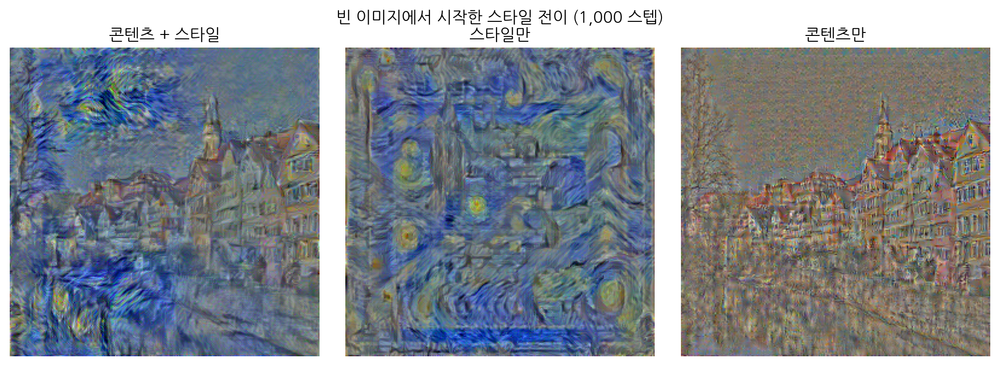
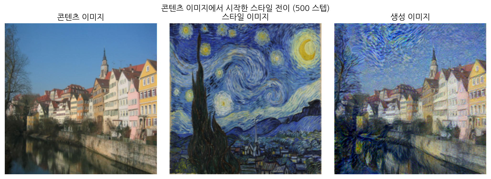
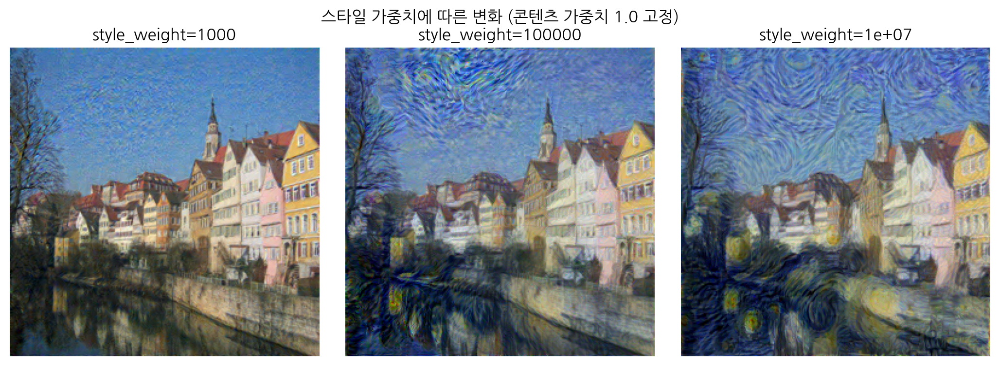

# 스타일 전이 — 모델 대신 이미지를 최적화하기

> 이 문서는 저자가 직접 내용을 작성하고, 교정 및 형식 정리에 AI의 도움을 받았음을 밝혀 둡니다.

> **11장 11-2절 심화 학습 자료**
>
> - 예제 노트북: [`style_transfer_example.ipynb`](style_transfer_example.ipynb)
> - 선수 지식: 5장(합성곱 신경망의 계층별 특징), 7장(전이 학습과 특징 추출), 11장(이미지 생성 전략)

11장은 이미지를 만드는 두 가지 방법을 설명하고 있다. 변분 오토인코더는 잠재 공간에서 벡터를 뽑아 디코더로 이미지를 만들었고, DCGAN은 생성자와 판별자를 경쟁시켜 만들었다. 둘 다 이미지를 만드는 모델의 파라미터를 학습 이미지를 사용해 최적화한 후, 이 모델을 사용해 이미지를 만드는 방식이다.

하지만 스타일 전이는 모델을 최적화하는 대신 **이미지의 픽셀을 직접 최적화**하는 방식으로 이미지를 생성한다. 이미지 딥러닝 모델을 사용하지 않는 것은 아니지만, 이미지를 직접 생성하는 대신 이미지의 특징을 추출하는 특징 추출기로 사전 학습된 모델을 사용한다. 독일 튀빙겐 거리 사진에 <별이 빛나는 밤>의 화풍을 입힌 이미지를 만든 방법이 바로 이것이다.

이번 심화 학습에서는 이 방법을 설명한다. 이미지를 만드는 또 하나의 전략을 제시하지만, 동시에 모델의 파라미터가 아닌 생성 결과물을 직접 최적화하는 새로운 관점을 소개하는 것이기도 하다.

---

## 1. 무엇을 최적화할 것인가

컴퓨터로 화풍을 옮기려는 시도는 딥러닝 이전부터 있었다. 사진에 붓 터치나 수채화 효과를 입히는 **비실사 렌더링**(non-photorealistic rendering)은 컴퓨터 그래픽스의 오랜 주제였고, 주로 픽셀의 통계적 특성을 분석해 대상 이미지에 더하는 방식을 썼다. 다만 화풍을 옮기기보다는 양식화된 효과를 입히는 쪽에 가까웠다.

스타일 전이는 이와 다른 방향의 접근법을 제시했다. 결과물은 획기적이었으나 발상은 매우 단순했다.

> 딥러닝이 손실을 줄이는 방향으로 **모델 파라미터**를 최적화하듯, 목적에 맞는 손실 함수를 정의할 수 있다면 **이미지의 픽셀값**도 같은 방식으로 최적화할 수 있다.

지금까지 학습한 다른 일반적인 학습 방식과 비교해 보자.

|                   | 일반적인 학습      | 스타일 전이                              |
| ----------------- | ------------------ | ---------------------------------------- |
| 고정              | 데이터             | **모델 파라미터**                        |
| 갱신              | 모델 파라미터      | **이미지 픽셀**                          |
| 손실              | 예측과 정답의 차이 | 생성 이미지와 두 기준 이미지의 특징 차이 |
| 학습 결과물 | 학습된 모델        | **한 장의 이미지**                         |

스타일 전이의 결과물은 모델이 아니라 **이미지 한 장**이다. 다른 사진에 같은 화풍을 입히려면 최적화 과정을 처음부터 반복해야 한다.

물론 딥러닝 모델을 쓰지 않는 것은 아니다. **스타일도 이미지의 특징**이고, 합성곱 신경망이 이미지의 특징 추출에 적합하다는 사실은 본문 5장과 8장에서 설명한 바 있다. 이미 학습된 합성곱 모델로 특징을 추출한 뒤, 그 특징을 기준으로 픽셀을 최적화한다.

이를 위해 다음의 방법 또는 도구가 필요하다.

1. 이미지에서 **필요한 특징을 분리**해 찾는 방법
2. 특징을 찾아서 뽑을 **특징 추출기**
3. **이미지 픽셀을 최적화**하는 방법

이를 차례로 풀어 보자.

---

## 2. 특징을 분리해 찾는 방법

### 2.1 스타일 전이에 필요한 특징

얼핏 생각하면 스타일 전이에는 스타일 특징만 필요하다고 생각하기 쉽다. 하지만 이미지에 어떤 특징을 더한다는 것은 원래의 이미지를 훼손하는 일이기도 하다. 즉, 스타일 전이는 새로운 스타일의 특징으로 이미지를 바꾸려는 노력과 원래 이미지의 특징으로 이미지를 지키려는 노력의 상호 경쟁으로 이루어진다. 

이를 위해서 다음과 같은 두 가지 특징이 필요하다.

- **콘텐츠 특징** — 원래 이미지(콘텐츠 이미지)의 내용으로 구성된 특징
- **스타일 특징** — 입히고자 하는 이미지(스타일 이미지)의 스타일만으로 구성된 특징으로, 스타일 이미지의 콘텐츠는 최대한 배제

두 특징의 경쟁에 가장 큰 걸림돌은 스타일 이미지의 콘텐츠 특징이다. 스타일 이미지의 콘텐츠가 생성 이미지에 드러나면 우리의 의도는 실패한 것이 된다. 

### 2.2 합성곱 계층을 구분해 특징을 추출하는 전략

우리의 의도를 지키려면 스타일 이미지에서는 콘텐츠 정보를 배제한 스타일 특징만, 콘텐츠 이미지에서는 그림의 내용에 충실한 콘텐츠 특징을 추출해야 한다. 이때 합성곱 신경망의 계층별 특성을 활용한다.

합성곱 신경망은 본문 5장에서 설명했듯 **깊은 계층일수록 사물의 형태나 구성 같은 고수준 특징**을, **얕은 계층일수록 색 분포, 질감, 붓 터치 같은 저수준 특징**을 추출한다.

2015년 독일 튀빙겐 대학교의 레온 가티스(Leon Gatys)는 이 성질에 주목해, 사전 학습된 VGG-19 하나로 두 가지 특징을 모두 뽑아낼 수 있음을 보였다.

- **콘텐츠 특징** — 깊은 합성곱 계층의 **한 곳**의 특징 지도. 그림에 무엇이 그려져 있는지를 담는다.
- **스타일 특징** — 얕은 합성곱 계층부터 깊은 합성곱 계층까지 **여러 계층**의 특징 지도. 붓 터치부터 전체 색조까지 고루 추출한다.

콘텐츠 손실은 두 특징 지도를 **그대로** 비교하면 된다. 생성 이미지의 특징 지도와 콘텐츠 이미지의 특징 지도 사이의 평균제곱오차를 손실 함수로 사용하면 되는데, 이 값이 작을수록 생성 이미지의 구조와 내용이 콘텐츠 이미지에 가깝다.

문제는 스타일이다. 특징 지도는 어느 계층에서든 공간 격자 구조라 위치 정보를 담고 있다. 따라서 스타일 특징 지도를 그대로 비교하면 **같은 위치에 같은 특징**이 있어야 손실이 줄어들고, 그 결과로 생성 이미지가 스타일 이미지의 배치, 즉 스타일 이미지의 콘텐츠를 흉내 내게 된다. 화풍은 "어디에 무엇이 있는가"가 아니라 "전반적으로 어떤 느낌인가"를 의미하므로, **위치 정보를 버리는 과정**이 추가로 필요하다.

### 2.3 그람 행렬 — 위치 정보를 버리고 관계만 남기기

합성곱 신경망은 이미지의 특징을 **채널별로 나눠** 추출한다. 1번 채널이 '노란색', 2번 채널이 '소용돌이 모양'을 잡아낸다고 하자. 그러면 1번 채널의 특징 지도는 노란 영역에서, 2번 채널의 특징 지도는 소용돌이가 있는 영역에서 큰 값을 가진다.

**그람 행렬**(Gram matrix)은 채널 쌍마다 값을 계산해 만든 정사각 행렬이다. `(i, j)` 요소는 채널 `i`와 채널 `j`의 특징 지도를 원소별로 곱한 뒤, **특징 지도 전체에 걸쳐** 모두 더한 값이다.

그람 행렬의 계산에는 다음 두 가지 원리가 적용된다.

- **같은 위치에서 두 특징이 함께 강하면** 곱이 커진다. 노란색과 소용돌이가 모두 `(3, 5)` 위치에 있다면, 원소별 곱 결과에서 `(3, 5)` 위치의 값이 커진다.
- 곱한 값을 **모두 더해** 그람 행렬의 요솟값 하나로 만들기 때문에, **어디에서** 특징이 강한지를 알 수 있는 위치 정보는 사라지고, 두 특징의 관계 정보만 남는다.

남는 것은 "**어떤 특징들이 함께 나타나는가**"뿐이다. <별이 빛나는 밤>이라면 '노란색 + 소용돌이'가 강하게 결합되어 있고, 이 결합 패턴은 그림의 여기저기에 비슷하게 퍼져 있다. 깊은 계층의 특징 지도도 위치를 버리고 나면 어떤 형태 조각들이 함께 나타나는지에 대한 질감 수준의 통계만 남으므로, 스타일 특징에 포함해도 콘텐츠 정보가 따라오지 않는다.

> **즉, 그람 행렬은 구체적인 형태를 지우고 스타일만 남긴 일종의 스타일 지문이다.**

두 이미지의 그람 행렬이 비슷하다는 것은, 픽셀값은 달라도 **질감과 색조의 통계가 비슷하다**는 뜻이다. 

```python
# (B, C, H, W) 형태의 특징 지도로 (B, C, C) 형태의 그람 행렬을 만든다
def gram_matrix(feature):
    B, C, H, W = feature.shape
    # 채널 단위의 1차원 벡터로 펼침: 공간 정보를 한 줄로 늘어놓는다
    f = feature.view(B, C, H * W)
    # 채널 벡터 사이의 내적 = 채널별 특징이 함께 나타나는 강도
    gram = torch.bmm(f, f.transpose(1, 2))      # (B, C, C)
    # 계층마다 채널 수와 공간 크기가 달라 정규화하지 않으면 한 계층이 압도한다
    return gram / (C * H * W)
```

코드로 표현한 그람 행렬 계산 과정은 단계마다 의미가 있다.

- **`view(B, C, H * W)`** — 내적은 1차원 벡터 사이의 연산이다. 세로와 가로를 한 축으로 펼쳐 채널마다 길이 `H*W`인 벡터를 만든다. **이 순간 공간 구조가 사라진다.** 픽셀을 어떤 순서로 늘어놓든 내적값은 같기 때문이다. 스타일에서 위치를 지우는 일이 바로 여기서 일어난다.
- **`torch.bmm(f, f.transpose(1, 2))`** — `(B, C, H*W)`와 `(B, H*W, C)`를 배치 행렬곱해 `(B, C, C)`를 얻는다. 배치 안의 모든 샘플을 한 번에 처리한다.
- **`/ (C * H * W)`** — 얕은 계층은 채널이 적고 특징 지도가 크며, 깊은 계층은 반대다. 정규화하지 않으면 특정 계층의 스타일 손실이 다른 계층을 압도한다. 여러 계층의 손실을 **비슷한 눈금으로 맞추는** 장치다.

스타일 이미지와 생성 이미지 각각의 그람 행렬의 요솟값 차이를 평균제곱오차로 집계하면 스타일 특징만 담아낸 스타일 손실이 된다.

### 2.4 두 손실을 합칠 때

두 특징을 경쟁해 생성 이미지의 픽셀을 최적화하려면 콘텐츠 손실과 스타일 손실을 합쳐야 한다. 이때 두 손실을 그냥 더하면 값의 차이로 인해 경쟁이 되지 않으므로 각각에 가중치를 곱해 더해야 한다.

```
전체 손실 = content_weight × 콘텐츠 손실 + style_weight × 스타일 손실
```

예제에서는 **가중치로 `1.0`과 `1e5`, 10만 배나 차이가 나는 값**을 기본값으로 사용한다. 두 손실의 계산 방식이 다르기 때문이다.

- 콘텐츠 손실은 **특징 지도의 픽셀별 오차**를 제곱 평균한 값이다.
- 스타일 손실은 **정규화한 그람 행렬의 요소별 오차**를 제곱 평균한 값이다. `/ (C * H * W)`로 이미 한 번 작게 만든 값을 다시 제곱하므로 훨씬 작아진다.

즉 10만이라는 숫자 자체에 의미가 있는 것이 아니라, **두 손실항에 가중치를 곱한 결과가 비슷한 크기가 되도록** 맞춘 것이다. 이미지 크기나 채널 수가 바뀌면 이 비율도 다시 잡아야 한다.

11-1절 VAE의 복원 손실과 KL 발산에서 본 것과 같은 구조다. **손실이 여러 항으로 이루어질 때는 항상 각 손실항의 균형을 확인해야 한다.**

---

## 3. 특징 추출기 만들기

### 3.1 VGG-19 특징 추출기로 사용하기

사전 학습된 VGG-19를 특징 추출기로 사용한다. 그런데 우리는 모델을 학습하는 것이 아닌 이미지를 최적화하므로 모델은 학습 대상이 아니다. 즉 모델의 파라미터가 바뀌지 않도록 고정해야 한다.

```python
class VGG19FeatureExtractor(nn.Module):
    def __init__(self, content_layer_idxs, style_layer_idxs):
        super().__init__()
        # ImageNet으로 학습한 파라미터로 초기화한 VGG-19
        vgg = models.vgg19(weights=models.VGG19_Weights.IMAGENET1K_V1)
        # 분류기는 쓰지 않고 합성곱 블록(features)만 사용
        self.features = vgg.features
        self.content_layer_idxs = content_layer_idxs
        self.style_layer_idxs = style_layer_idxs
        # 이미지를 최적화할 때 VGG-19가 함께 갱신되지 않도록 고정
        for param in self.parameters():
            param.requires_grad = False

    def forward(self, x):
        content_features, style_features = {}, {}
        # 계층을 순서대로 통과시키며 지정한 위치의 특징 지도를 수집
        for idx, layer in enumerate(self.features):
            x = layer(x)
            if idx in self.content_layer_idxs:
                content_features[idx] = x
            if idx in self.style_layer_idxs:
                style_features[idx] = x
        return content_features, style_features
```

**`requires_grad = False`에 주목하자.** 7장의 특징 추출 방식 전이 학습에서 사전 학습 모델을 고정한 것과 같은 방식이지만, 목적이 다르다. 7장에서는 **추가한 분류기**만 학습하려는 의도로 고정했지만, 여기서는 **생성 이미지**만 학습하려는 의도로 고정한다.

최적화 과정에서 계산한 기울기는 여전히 VGG-19 모델을 **거쳐** 흐른다. 다만 그 끝이 모델 파라미터가 아니라 입력 이미지일 뿐이다.

**`forward()`가 중간 출력을 모으는 구조**에도 주목하자. 보통 모델은 마지막 출력만 돌려주지만, 여기서는 여러 계층의 특징 지도가 필요하다. `nn.Sequential`을 그대로 호출하는 대신 계층을 하나씩 돌며 필요한 정보(특징)를 수집한다.

> **파이토치 훅(8장 심화 학습 자료 참조)으로도 같은 일을 할 수 있다.** 훅을 쓰면 `forward()`를 새로 쓰지 않고도 중간 특징을 꺼낼 수 있다. 이 예제는 추출할 계층이 미리 정해져 있고 구조가 단순해 직접 순회하는 쪽을 택했다. 이번 예제와 달리 모델의 구조를 수정할 수 없는 경우에는 파이토치 훅이 유일한 방법이 될 수도 있다.

### 3.2 특징을 추출할 계층

```python
# 콘텐츠: 중간보다 약간 깊은 한 계층
content_layer_idxs = [21]
# 스타일: 얕은 곳부터 깊은 곳까지 고루
style_layer_idxs = [0, 5, 10, 19, 28]
```

`torchvision`의 VGG-19에서 `features`는 `nn.Sequential`의 객체로, 구성 계층의 순서에 해당하는 인덱스로 구성 계층 객체에 접근할 수 있다. 합성곱 계층은 모두 16개이지만, 활성화 계층, 풀링 계층 등이 섞여 있어 합성곱 계층의 순서만으로 인덱스가 정해지지 않는다. 특징 추출에 사용하는 계층은 다음과 같다.

- **콘텐츠 특징은 인덱스 21의 합성곱 계층**(열 번째 합성곱 계층) 하나에서만 추출한다. 중간보다 약간 깊은 위치다.
- **스타일 특징은 인덱스 0, 5, 10, 19, 28의 다섯 합성곱 계층**에서 추출한다. 첫 번째 합성곱 계층에서 열세 번째 합성곱 계층에 걸쳐 골고루 선택한 것이다.

그런데 **콘텐츠 특징을 가장 깊은 계층에서 추출하지는** 않는다. VGG-19는 이미지 분류로 학습된 모델이라 사물이 어디에 있든 같은 답을 내야 하므로, 깊은 계층일수록 이동 불변성이 커지고 위치 정보가 사라진다. 그래서 **가장 깊은 합성곱 계층에는 "건물과 강이 있다"는 사실만 남고 그림의 구도는 거의 남지 않는다.** 반대로 너무 얕은 계층을 쓰면 픽셀을 거의 그대로 베끼게 되어 스타일이 들어갈 자리가 없다. **torchvision 기준 인덱스 21(열 번째 합성곱 계층)이 그 사이의 타협점이다.** 연습 문제 2에서 직접 확인한다.

### 3.3 입력 이미지 맞추기

```python
IMG_SIZE = 256

def load_image(path, size=IMG_SIZE):
    img = Image.open(path).convert('RGB')
    transform = transforms.Compose([
        transforms.Resize((size, size)),
        transforms.ToTensor(),
        # VGG-19가 학습된 ImageNet의 정규화 값을 그대로 쓴다
        transforms.Normalize(mean=[0.485, 0.456, 0.406],
                             std=[0.229, 0.224, 0.225]),
    ])
    return transform(img).unsqueeze(0).to(device)
```

VGG-19는 ImageNet을 평균 `[0.485, 0.456, 0.406]`, 표준편차 `[0.229, 0.224, 0.225]`로 정규화해 학습했다. **모델을 재활용하려면 입력 분포도 맞춰야 한다.** 

이 정규화 때문에 **결과를 볼 때는 되돌려야 한다.** 예제 노트북의 `denormalize()`가 그 일을 한다.

---

## 4. 이미지를 최적화하기

### 4.1 두 가지 준비

이미지 텐서를 모델 파라미터처럼 다루려면 두 가지 사전 준비가 필요하다.

```python
# ① 이미지 텐서를 최적화 대상으로 만든다
generated = init_img.clone().detach().requires_grad_(True)
# ② 모델 파라미터가 아니라 이 텐서를 옵티마이저에 넘긴다
optimizer = optim.Adam([generated], lr=0.03)
```

`optim.Adam(model.parameters(), ...)`에서 `model.parameters()`는 파라미터 텐서의 이터러블이다. 그 자리에 **텐서 하나를 담은 리스트**를 넣으면 그 텐서가 최적화 대상이 된다. 옵티마이저는 대상이 모델 파라미터인지 이미지인지 구분하지 않고, 텐서면 최적화 대상으로 삼는다.

**`clone().detach()`도 빠뜨리면 안 된다.** 콘텐츠 이미지에서 출발할 때 복사하지 않으면 **콘텐츠 이미지 자체가 함께 바뀐다.** 이로 인해 이후 실험의 출발점과 비교 기준이 오염된다.

### 4.2 학습 루프

```python
# 기준 특징은 한 번만 추출한다(두 기준 이미지는 바뀌지 않는다)
with torch.no_grad():
    content_image_features, _ = feature_extractor(content_img)
    _, style_image_features = feature_extractor(style_img)

for step in range(1, steps + 1):
    optimizer.zero_grad()
    # 생성 이미지는 매 스텝 바뀌므로 특징도 매번 새로 뽑는다
    gen_content, gen_style = feature_extractor(generated)
    loss, content_loss, style_loss = criterion(
        gen_content, gen_style,
        content_image_features, style_image_features,
        content_weight, style_weight,
    )
    loss.backward()
    optimizer.step()
    # 정규화 범위를 크게 벗어나는 픽셀값을 잘라 낸다
    with torch.no_grad():
        generated.clamp_(-3, 3)
```

일반적인 학습 루프와 모양이 똑같다. 바뀐 것은 **최적화 대상**과 **손실의 정의**뿐이다.

기준 특징은 **루프 밖에서 한 번만** 뽑는다. 두 기준 이미지는 바뀌지 않으므로 특징도 바뀌지 않는다. 매 스텝마다 다시 뽑으면 같은 계산을 헛되이 반복하게 된다. 이 특징들은 손실을 계산할 때 쓰는 정답(목표값)이다. 분류 모델을 학습할 때 정답 레이블의 기울기를 구하지 않듯, 여기서도 `torch.no_grad()` 콘텍스트 내부에서 뽑아 기울기 추적 없이 상수처럼 사용한다. 반대로 생성 이미지의 특징은 픽셀이 바뀔 때마다 달라지고 기울기도 흘러야 하므로 매 스텝마다 새로 뽑는다.

> 사실 기준 이미지 텐서와 VGG-19 파라미터 텐서는 기울기 계산이 꺼져 있어 `torch.no_grad()` 콘텍스트 적용 여부와 무관하게 최적화되지 않는다. 그래도 콘텍스트를 적용하면 의도를 분명하게 표현할 수 있다.

**`clamp_(-3, 3)`은 안전장치다.** ImageNet 이미지는 정규화 후 채널별 픽셀값이 대체로 `-2.1`에서 `2.6` 범위에 들어온다. 최적화 과정에서 픽셀이 그 바깥으로 튀면 **VGG-19가 본 적 없는 입력**이 되어 특징 추출이 엉뚱해진다. `-3`에서 `3`으로 제한하면 약간의 여유는 주면서 극단값은 막는다.

### 4.3 큰 학습률을 사용하는 이유

사용하는 학습률의 값 **`0.03`**은 다른 모델의 학습에 사용한 학습률과 비교하면 수십 배 이상 큰 값이다. 두 가지 이유를 꼽을 수 있다.

**하나, 정답이 고정되어 있다.** 모델 학습은 데이터가 배치마다 바뀌어 손실 지형이 계속 흔들리지만, 스타일 전이는 콘텐츠와 스타일이 처음부터 끝까지 그대로다. 같은 목표를 향해 계속 내려가므로 큰 보폭에도 안전한 최적화가 가능하다.

**둘, 픽셀은 모델 파라미터보다 값의 크기가 크다.** Adam 옵티마이저의 최적화 결과로 한 스텝에 움직이는 크기는 기울기의 크기와 상관없이 대략 학습률 정도다. 모델의 가중치는 보통 0.01 ~ 0.1 안팍의 작은 값이라 `1e-3` 정도의 작은 학습률로도 충분하다. 반면 정규화된 픽셀은 약 -2 ~ 2.6 정도에 걸쳐 있어, 같은 학습률로는 너무 느리게 움직인다. 

> **가티스의 원 논문은 옵티마이저로 Adam 대신 L-BFGS를 사용한다.** L-BFGS는 2차 미분 정보를 근사해 쓰는 옵티마이저로, 배치 없이 전체 손실을 매번 똑같이 계산하는 문제에서 훨씬 빠르게 수렴한다. 스타일 전이는 그 조건에 정확히 들어맞는다. 다만 `optim.LBFGS`는 손실을 다시 계산하는 `closure` 함수를 넘겨야 해서 학습 루프의 모양이 달라진다. 이 글은 지금까지 써 온 형태를 유지하려고 Adam을 썼다.

---

## 5. 결과 읽기

### 5.1 빈 이미지에서 시작하면

생성 이미지를 `torch.zeros_like(content_img)`로 만든 단색 이미지(정규화 공간의 0, 즉 ImageNet 평균색)로 시작한 후 1,000번 반복해 최적화한 결과는 다음과 같다. 비교를 위해 콘텐츠 가중치를 0으로 두고 스타일 특징만 사용한 결과와 스타일 가중치를 0으로 두고 콘텐츠 특징만 사용한 결과도 함께 만들어 보았다.



우선 스타일 특징만 쓴 결과와 콘텐츠 특징만 쓴 결과부터 살펴보자. 뒤의 두 결과 이미지에 해당한다.

- **스타일 특징만 사용**(콘텐츠 가중치 0) — 화면이 스타일로 가득 찬다. 튀빙겐 거리는 흔적도 없고, 질감과 색조는 <별이 빛나는 밤> 그대로다.
- **콘텐츠 특징만 사용**(스타일 가중치 0) — 첨탑과 건물의 형태는 **또렷이 복원**되지만 색이 바랬고 전체에 잡티가 낀다. 색조와 질감은 스타일 이미지와 무관하다.

한편 두 특징을 모두 사용한 첫 번째 결과는 스타일과 콘텐츠 모두 흉내를 내지만, 생성 결과의 품질은 기대에 미치지 못한다.

**빈 화폭**에서는 콘텐츠만 맞추면 손실이 0.05까지 내려가지만, 스타일과 함께 맞추면 1.47에서 멈춘다. 그래서 둘을 함께 쓴 첫 번째 결과도 "스타일이 전이된 그림"이라기보다 **"뭉개진 콘텐츠 위에 스타일을 겹쳐 놓은 것"**에 가깝다. 특히 화면 아래쪽 강변은 형태가 거의 사라졌다.

스타일은 이미지 어디에나 흩어져 있어도 되지만, 콘텐츠는 **특징 지도의 자리마다** 값을 맞춰야 한다. 스타일 손실은 **공간 정보를 버린** 그람 행렬을 맞추므로 픽셀을 대충 배치해도 값이 내려간다. 반면 콘텐츠 손실은 자리까지 맞춰야 하므로, 스타일과 경쟁하기가 매우 버겁다.

### 5.2 콘텐츠 이미지에서 시작하면

이를 해결하는 방법은 간단하다. **단색 이미지 대신 콘텐츠 이미지에서 시작하면 된다.**

```python
generated = content_img.clone().detach().requires_grad_(True)
```

출발 지점을 바꾸면 문제의 성격이 "빈 화폭에 콘텐츠와 스타일을 모두 그린다"에서 **"이미 있는 콘텐츠를 지키면서 스타일만 입힌다"**로 바뀐다. 콘텐츠 손실이 0에서 출발하므로 최적화는 스타일을 입히면서 콘텐츠가 얼마나 흐트러지는지만 조절하게 된다.



500 스텝만으로 훨씬 나은 결과가 나온다. 최종 콘텐츠 손실도 1.47(빈 이미지, 1,000 스텝)에서 1.30(500 스텝)으로 낮다. **초기값을 바꾸는 것만으로 절반의 스텝에 더 좋은 결과를 얻은 셈**이다. 최적화 문제에서 출발점이 얼마나 중요한지 보여 주는 사례다.

### 5.3 가중치로 강도 조절하기

콘텐츠 가중치를 `1.0`으로 두고 스타일 가중치만 `1e3`, `1e5`, `1e7`로 바꿔 본 결과다.



- **`1e3`** — 스타일이 거의 보이지 않는다. 원본 사진에 가깝다.
- **`1e5`** — 기본값. 내용을 알아볼 수 있으면서 화풍이 뚜렷하다.
- **`1e7`** — 스타일이 지나쳐 **건물의 구조가 무너지기 시작한다.**

가중치는 **'스타일의 강도 스위치'** 역할을 한다. 다만 세 번째 결과가 보여 주듯, 스타일을 강하게 입힌다는 것은 곧 **콘텐츠 이미지에서 멀어진다**는 뜻이다. 둘은 근본적으로 맞바꿈 관계이므로 왜곡이 싫다면 적당한 스타일 전이 수준에서 만족하는 수밖에 없다.

---

## 6. 정리와 그다음

**스타일 전이가 보여 주는 것은 기법 하나가 아니라 관점이다.**

|                | 내용                                                                                  |
| -------------- | ------------------------------------------------------------------------------------- |
| 최적화 대상    | 모델 파라미터가 아니어도 된다. **기울기가 흐르는 텐서면 무엇이든** 가능하다           |
| 손실 함수      | 파이토치가 주는 것을 쓰지 않아도 된다. **목적 함수를 수식으로 옮길 수 있으면** 만들면 된다 |
| 사전 학습 모델 | 분류 모델을 분류에 쓰지 않고, **특징 추출기로 재활용**할 수 있다                         |
| 여러 손실항    | 합치기 전에 **눈금이 맞는지** 먼저 확인해야 한다                                      |

이 관점은 다른 곳에서도 쓰인다. 입력을 최적화해 모델을 속이는 **적대적 예제**(adversarial example), 특정 뉴런을 최대로 활성화하는 입력을 찾아 모델이 무엇을 보는지 알아내는 **특징 시각화**(feature visualization)가 모두 같은 구조다.

**한계도 분명하다.** 이 방법은 이미지 한 장마다 수백 번의 최적화가 필요하다. 실시간으로는 쓸 수 없다. 11장 학습 노트에서 언급한 **AdaIN**(adaptive instance normalization)은 이 문제의 해결책이다. 스타일을 "특징 지도의 채널별 평균과 표준편차"로 보고, 콘텐츠 특징의 통계를 스타일 특징의 통계로 바꿔치기하는 방식이다. 디코더를 미리 학습해 두면 최적화 없이 **단일 순전파**로 끝나므로 영상에도 적용할 수 있다.

---

## 연습 문제

### 1. 가중치의 비율과 절댓값

예제에서 쓰지 않은 스타일 가중치를 골라 가장 마음에 드는 결과를 찾아보자. 이때 **콘텐츠 가중치도 `0.1`, `1.0`, `10.0` 등으로 함께 바꿔 가며**, 두 가중치의 **비율**이 결과를 좌우하는지 아니면 **절댓값**도 영향을 주는지 정리해 보자.

### 2. 콘텐츠 특징을 뽑는 계층 바꾸기

예제는 VGG-19의 16개 합성곱 계층 중 열 번째(인덱스 21)에서 콘텐츠 특징을 뽑는다. 이를 각각 **첫 번째, 여섯 번째, 열여섯 번째** 합성곱 계층으로 바꿔 결과를 확인한 뒤, 열 번째라는 선택이 타당한지 평가해 보자.

> 계층 인덱스는 `feature_extractor.features`를 출력해 확인할 수 있다.

### 3. 고주파 스타일과 저주파 스타일 나누기

스타일은 규모에 따라 나눌 수 있다. **미세한 붓 터치나 캔버스 질감** 같은 작은 규모의 특징(고주파)과, **전반적인 색조나 큼직한 형태의 왜곡** 같은 큰 규모의 특징(저주파)이다.

특정 범위(예를 들어 13x13 영역) 안에서만 관찰되는 특징을 고주파, 그보다 큰 것을 저주파로 정의할 때, VGG-19를 특징 추출기로 쓰면서 **고주파만** 또는 **저주파만** 전이하는 방법을 제시하고 구현해 보자.

> 힌트: 계층이 깊어질수록 한 뉴런이 보는 원본 영역(수용 영역)이 넓어진다. `style_layer_idxs`를 어떻게 고르면 될지 생각해 보자.

### 4. [도전 문제] 스타일 이미지의 크기 바꾸기

스타일 이미지는 생성 이미지와 같은 크기일 필요가 없다. `data/starry_night.jpg`는 원래 큰 이미지인데 예제는 256x256으로 줄여 쓴다. **크기를 줄이지 않고 그대로** 사용해 전이해 보고, 결과에 어떤 차이가 있는지 확인해 보자.

> 왜 크기가 달라도 되는지 먼저 생각해 보자. 그람 행렬의 형태는 무엇으로 정해지는가?

### 5. [도전 문제] 두 화풍 섞기

<별이 빛나는 밤>과 비슷한 시기에 그려진 또 하나의 명화로 에드바르 뭉크의 <절규>(`data/the_scream.jpg`)를 꼽을 수 있다. 두 그림의 스타일을 **동시에** 전이해 <별이 절규하는 튀빙겐 거리>를 만들어 보자.

---

## 사용하는 데이터와 모델

### 이미지 출처와 라이선스

| 파일 | 출처 | 라이선스 |
|---|---|---|
| `data/Tuebingen_Neckarfront.jpg` | Andreas Praefcke, [Tuebingen Neckarfront.jpg](https://commons.wikimedia.org/wiki/File:Tuebingen_Neckarfront.jpg), 위키미디어 커먼스, 2003 | [CC BY 3.0](https://creativecommons.org/licenses/by/3.0/deed.ko) |
| `data/starry_night.jpg` | 빈센트 반 고흐, <별이 빛나는 밤>(1889), 뉴욕 현대미술관 소장. [Van Gogh - Starry Night - Google Art Project.jpg](https://commons.wikimedia.org/wiki/File:Van_Gogh_-_Starry_Night_-_Google_Art_Project.jpg), 위키미디어 커먼스 | 퍼블릭 도메인 |
| `data/the_scream.jpg` | 에드바르 뭉크, <절규>(1893), 노르웨이 국립미술관 소장, 촬영 Børre Høstland. [Edvard Munch, 1893, The Scream, … National Gallery of Norway.jpg](https://commons.wikimedia.org/wiki/File:Edvard_Munch,_1893,_The_Scream,_oil,_tempera_and_pastel_on_cardboard,_91_x_73_cm,_National_Gallery_of_Norway.jpg), 위키미디어 커먼스 | 퍼블릭 도메인 |

- 튀빙겐 사진은 예제에서 256×256으로 크기를 줄여 사용했고, 이 문서의 `figures/` 그림 3장에는 이 사진을 스타일 전이로 변형한 결과가 포함되어 있다. 이 변형 이미지도 같은 CC BY 3.0 조건(저작자 표시)을 따른다.
- 두 그림은 저작권 보호 기간이 끝난 작품이다. 위키미디어 커먼스는 이런 2차원 미술품의 충실한 복제 사진도 퍼블릭 도메인으로 본다. 
- 각 파일은 2026년 10월 기준 위키미디어 커먼스 페이지의 라이선스 표기를 확인했다.

### 모델 정보

| 모델   | 출처                                    | 사전 학습 데이터 | 라이선스     |
| ------ | --------------------------------------- | ---------------- | ------------ |
| VGG-19 | `torchvision` 내장 모델(`models.vgg19`) | ImageNet-1k      | 아래 설명 참고 |

`torchvision`의 코드는 BSD-3-Clause 라이선스이지만, 사전 학습 가중치는 별도의 라이선스를 명시하지 않는다. 가중치를 배포하는 `torchvision`은 "사전 학습 모델에는 학습 데이터셋에서 비롯된 별도의 이용 조건이 있을 수 있으며, 용도에 맞는 사용 권한을 확인할 책임은 이용자에게 있다"고 밝힌다. 학습에 쓰인 ImageNet은 비상업적 연구, 교육 목적으로만 이용하도록 제한한다. 이 책은 교육 목적으로 가중치를 내려받아 쓰며 재배포하지 않는다. 상업적 서비스에 활용하려면 [torchvision 안내](https://github.com/pytorch/vision#pre-trained-model-license)와 [ImageNet 이용 약관](https://image-net.org/accessagreement)을 확인하자.

## 실행 환경

예제 노트북은 저장소 전체를 내려받은 상태에서 이 디렉터리 안에서 실행하는 것을 전제로 한다. 공통 라이브러리(`code_reference`)를 사용하므로, 저장소를 통째로 clone하지 않았다면 `code_reference/README.md`를 먼저 확인하자.

VGG-19 사전 학습 가중치를 내려받으므로 **첫 실행에는 네트워크 연결이 필요하다**(약 550MB).
